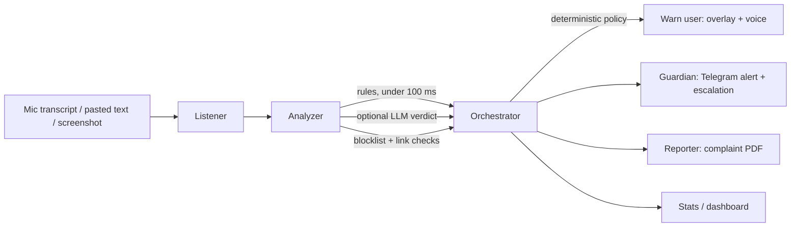

# 🛡️ Scam Shield

**A real-time scam co-pilot for India.** Scam Shield sits next to a vulnerable user, spots digital-arrest, fake-KYC and UPI fraud in **Hindi, English and Hinglish**, warns them out loud in their own language, and pulls in their family before the money moves.

> Built for elderly and first-time digital users: big buttons, plain words, a spoken warning, and a family "guardian" who gets alerted on Telegram.

---

## ✨ Features

| | Feature | What it does |
|---|---|---|
| 🔍 | **Message & screenshot check** | Paste a text or upload a screenshot. Get a verdict (SAFE / SUSPICIOUS / SCAM), a 0-100 risk score, highlighted evidence and simple next steps in English and Hindi. |
| 🎙️ | **Live call listener** | Listens through the device mic (speakerphone), scores the call as it unfolds, and fires a full-screen warning with a **spoken Hindi/English alert**. |
| 👨‍👩‍👧 | **Guardian loop** | Alerts a linked family member on Telegram with the evidence. If nobody taps "I am calling them" in time, it **escalates to a backup guardian**. |
| 📄 | **One-tap complaint PDF** | Evidence pack with signal timeline, numbers and UPI IDs found, and the 1930 / cybercrime.gov.in steps. |
| 🧠 | **Weighted "what are they asking for?" detection** | Asking for an OTP, PIN, CVV, card number, bank details, Aadhaar, etc. adds risk points per item. Protective wording ("never share your OTP") is ignored. |
| 🔗 | **Link / number / UPI checker** | Offline checks for fake bank look-alike sites, APK links, shorteners, foreign numbers, scammy UPI names, plus a community blocklist. |
| 🎭 | **Practice mode** | An AI plays a fictional scammer; a coach tells you whether each reply was safe. |
| 📊 | **Impact dashboard** | Scams caught by type, day and language. Money saved is clearly labelled an **estimate**. |
| 🔒 | **Privacy by design** | Audio is never sent or stored. Text is kept only if the user opts in, and auto-purged after 24 h. |

### Scam types detected

Digital arrest · fake KYC / bank call · UPI collect & QR tricks · remote-access apps (AnyDesk etc.) · courier/parcel · lottery & prize · investment · fake jobs/tasks · fake bill-disconnection · "relative on a new number" · sextortion · loan-app fee scams.

---

## 🧩 How it works



**The safety-critical path is deterministic.** The alert fires from the fast rules pass the moment the live score reaches 70. The LLM only refines the score and writes explanations, and it **never blocks or delays an alert**. If the LLM is slow, down, or not configured, everything still works.

### Detection in three layers

1. **Rules (under 100 ms):** regex patterns for Hindi (Devanagari), romanized Hinglish and English, with spelling variants and tricks like "O T P" or "C.B.I".
2. **Entities & links:** phones, UPI IDs, URLs, apps and amounts are extracted and checked against the community blocklist and offline link heuristics.
3. **Optional LLM:** Anthropic, Gemini or OpenAI, blended as `0.4 × rules + 0.6 × LLM`, and **never below the rules' hard floors**.

**Hard floors** make sure classic combinations always alert, for example: remote-access app + payment demand → 85; fake officer + secrecy or payment → 85; asking for any secret (OTP, PIN, CVV, card number, password) → 70; fake bank link → 70.

### The risk-word table

What a scammer *asks for* decides the score. The weights live in [`backend/app/data/scam_patterns.json`](backend/app/data/scam_patterns.json) under `credential_items`, so you can tune them without touching code.

| Asked for | Points | | Asked for | Points |
|---|---|---|---|---|
| UPI / ATM PIN | 50 | | Aadhaar | 35 |
| OTP, CVV | 45 | | PAN card | 30 |
| Card number, password | 40 | | Account number / bank details | 25 |
| Customer ID, ID photo, selfie | 20 | | Expiry / IFSC | 15 / 10 |

Items only count when there is a request ("give me", "share", "batao", "bhejo"…) and no protective wording. "Do not share your OTP" scores 0.

---

## 🧱 Tech stack

- **Frontend:** Next.js 14 (App Router), TypeScript, Tailwind, Recharts, installable PWA. Browser Web Speech API for speech-to-text and text-to-speech (use **Chrome**).
- **Backend:** FastAPI + WebSocket, SQLite (SQLAlchemy async), ReportLab for PDFs, Pydantic v2.
- **LLM:** provider-agnostic wrapper (Anthropic / Gemini / OpenAI) plus a built-in **mock client**, so everything runs with **no API key**.
- **Alerts:** Telegram bot (long-polling) with an inline acknowledge button.

---

## 🚀 Quick start

You need **Node 18+**, **Python 3.11+** and **Chrome**.

### 1. Backend

```bash
cd backend
python -m venv .venv
# Windows:  .venv\Scripts\activate        macOS/Linux:  source .venv/bin/activate
python -m pip install -r requirements.txt
python -m uvicorn app.main:app --reload
```

Open http://localhost:8000/docs to see every endpoint. It works with an **empty `.env`** (mock mode).

### 2. Frontend

```bash
cd frontend
cp .env.local.example .env.local      # Windows: copy .env.local.example .env.local
npm install
npm run dev
```

Open http://localhost:3000.

> **No backend yet?** Set `NEXT_PUBLIC_MOCK=1` in `frontend/.env.local` to click through every page with built-in sample data.

### 3. Try the demo

Go to **http://localhost:3000/live?demo=hinglish**. A fake CBI "digital arrest" call replays through the same WebSocket. The risk meter climbs, signals appear, and the warning overlay fires with a spoken alert about 16 seconds in.

---

## ⚙️ Configuration

Backend settings are read from a `.env` file in the repo root (or `backend/`). All are optional.

| Variable | Default | Purpose |
|---|---|---|
| `LLM_PROVIDER` | `mock` | `mock`, `anthropic`, `gemini` or `openai` |
| `LLM_MODEL` | *(empty)* | Model name from your provider's docs (never hardcoded) |
| `ANTHROPIC_API_KEY` / `GEMINI_API_KEY` / `OPENAI_API_KEY` | | Key for the chosen provider |
| `TELEGRAM_BOT_TOKEN` / `TELEGRAM_BOT_USERNAME` | | Empty = Telegram mock mode |
| `ACK_TIMEOUT_S` | `60` | Seconds before escalating to the backup guardian |
| `AVG_LOSS_PREVENTED_INR` | `25000` | Used for the *estimated* money-saved number |
| `DATA_TTL_HOURS` | `24` | When saved raw text is purged |
| `FRONTEND_ORIGIN` | `http://localhost:3000` | Allowed CORS origin |

Frontend (`frontend/.env.local`): `NEXT_PUBLIC_API_URL`, `NEXT_PUBLIC_WS_URL`, `NEXT_PUBLIC_MOCK`.

### Mock mode vs live mode

| | Mock mode (no keys) | Live mode |
|---|---|---|
| Detection | Full rules engine | Rules + LLM |
| Telegram | Guardians auto-linked, alerts logged as `[MOCK TELEGRAM]` | Real bot messages with ack button |
| Screenshot check | Returns a canned sample transcription | Real OCR through the vision LLM |

The header shows a **Demo mode / Live mode** badge.

### Setting up Telegram (optional)

1. Message **@BotFather** on Telegram, run `/newbot`, copy the token and username.
2. Put them in `.env` as `TELEGRAM_BOT_TOKEN` and `TELEGRAM_BOT_USERNAME`.
3. In the app, go to **Family → Set up family protection**. The guardian scans the QR code and presses Start.

---

## 🔌 API overview

Interactive docs live at `/docs`. The full contract is in [`docs/CONTRACT.md`](docs/CONTRACT.md).

| Endpoint | Purpose |
|---|---|
| `POST /api/analyze/text` · `POST /api/analyze/image` | Check a message or screenshot |
| `WS /ws/live` | Live call: transcript in, `risk_update` / `scam_alert` / `session_summary` out |
| `POST /api/guardian/link` · `GET /api/guardian/{user_id}` | Family setup and status |
| `POST /api/alerts/send` · `GET /api/alerts/{user_id}` · `POST /api/alerts/{id}/ack` | Alerts and acknowledgement |
| `POST /api/report/generate` · `GET /api/report/{id}.pdf` | Complaint PDF |
| `POST /api/check/entity` | Check one phone / UPI ID / link |
| `POST /api/blocklist/report` | Report a number, UPI ID or link |
| `POST /api/feedback` · `GET /api/analysis/{id}` | "This was wrong" feedback; fetch a result |
| `GET /api/stats` · `GET /api/health` | Dashboard numbers; status |
| `POST /api/simulator/start` · `POST /api/simulator/turn` | Practice mode |
| `GET /api/demo/call?variant=hinglish\|english\|benign` | Replay calls |

---

## 🗂️ Project structure

```
scam-shield/
├── backend/
│   ├── app/
│   │   ├── api/          REST + WebSocket routes
│   │   ├── agents/       orchestrator (live loop), guardian, coach, event bus
│   │   ├── detection/    rules, entities, scoring, link checks, explanations
│   │   ├── llm/          provider clients, mock client, prompts
│   │   ├── services/     telegram, pdf_report, ocr, blocklist, purge
│   │   ├── models/       schemas + database tables
│   │   └── data/         scam_patterns.json, blocklist seed, demo calls
│   └── tests/            pytest suite (105 tests)
├── frontend/
│   └── src/
│       ├── app/          pages: home, check, live, guardian, dashboard, practice, report
│       ├── components/   RiskMeter, WarningOverlay, ResultCard, …
│       ├── hooks/        speech recognition, TTS, live socket
│       └── lib/          api client (with mock mode), i18n, types
└── docs/                 CONTRACT.md and notes
```

---

## 🧪 Tests

```bash
cd backend
python -m pytest -q
```

Covers the rules engine (English, Hindi, Hinglish, and protective-wording negatives), entity extraction, scoring floors, every API endpoint, the live WebSocket flow (alert fires **exactly once**), guardian escalation, the privacy purge, and the entity checker.

Frontend type check: `cd frontend && npx tsc --noEmit`.

---

## 🔐 Privacy & security

- **Audio never leaves the device.** Only text is analysed.
- Raw messages and transcripts are saved **only if the user opts in**, and are purged after `DATA_TTL_HOURS`.
- The PDF includes the transcript only if the user chose to save it.
- **Never commit `.env`.** It is already in `.gitignore`. If a key was ever pushed, revoke it at the provider and remove it from git history.

---

## ⚠️ Limits (said honestly)

- A browser **cannot tap into a cellular call.** The live demo works with the call on **speakerphone** next to the device mic, or with replay mode. A native Android companion is the real production path.
- Speech recognition needs Chrome and an internet connection.
- Detection is rules-first and tuned for common Indian scam patterns. It is a safety aid, **not a guarantee**. The PDF is a generated aid, **not an FIR**.
- The "money saved" figure is a configurable estimate, not measured savings.
- PDF Hindi text depends on a Devanagari font being present on the machine.
- Not yet included: a labelled evaluation dataset with precision/recall numbers.

---

## 🛣️ Roadmap

- Native Android companion with on-device processing
- Labelled eval set (precision / recall / F1 per language) wired into CI
- WhatsApp "forward to check" bot
- Punjabi, Tamil, Bengali and other Indian languages
- Family safe-word reminders
- Partnerships with banks, telecoms and UPI apps for the community blocklist

---

## 🆘 If you've been scammed

Call **1930** (national cyber crime helpline) immediately, report at **cybercrime.gov.in**, tell your bank to block the transaction, and don't delete messages or call logs.

---

## 📜 License

Add your license here (for example MIT).
